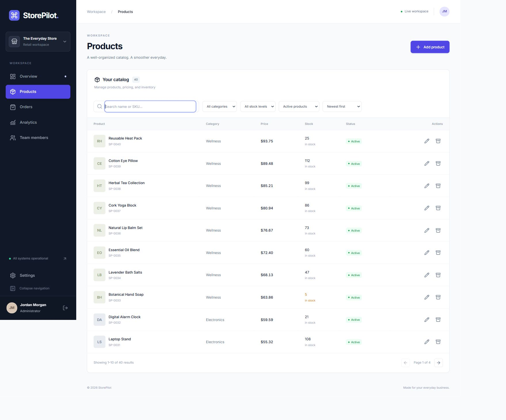
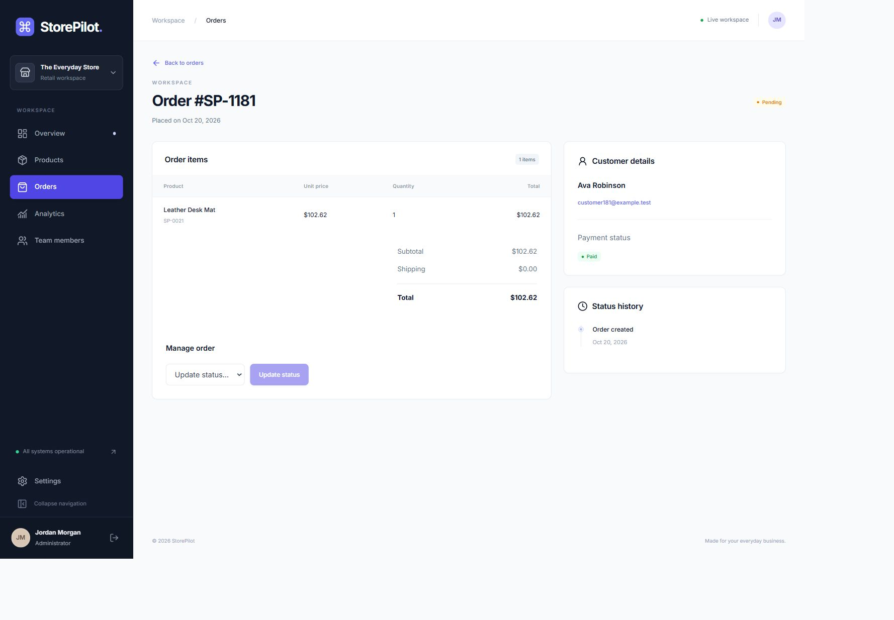
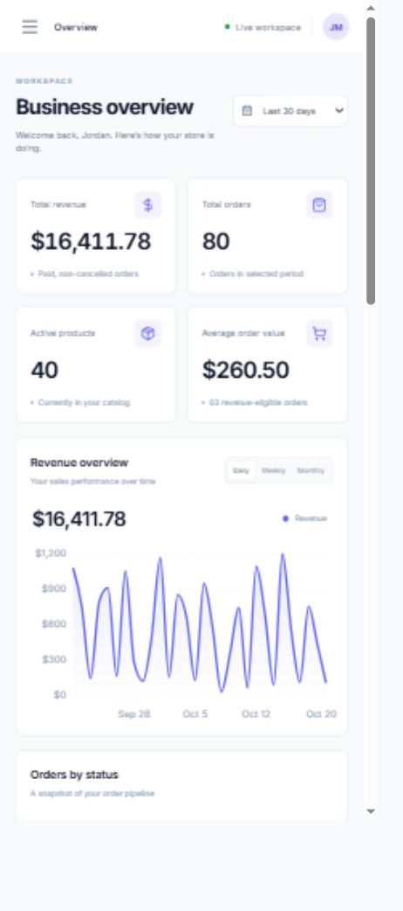

# StorePilot

A responsive retail management app for tracking products, fulfilling orders, reviewing sales, and managing a small team. The project includes a React dashboard, an Express API, and a MongoDB-backed application, plus a browser-only portfolio demo.

**[Try the live demo](https://storepilot-brown.vercel.app)** · [View screenshots](#screenshots)

## What you can do

- **Dashboard and analytics:** view revenue, order trends, top products, category performance, and low-stock alerts.
- **Products:** create and edit products, search by name or SKU, filter and sort the catalog, and archive products without losing order history.
- **Orders:** inspect item snapshots, move orders through fulfillment, and review status history. Admins can cancel eligible orders.
- **Team and settings:** manage staff access, update the shop profile, and change account details.
- **Roles:** staff can view the dashboard, catalog, and orders and advance fulfillment; admins can also manage products, cancellations, team members, analytics, and shop settings.

## Screenshots


| Products | Order details | Mobile dashboard |
| --- | --- | --- |
|  |  |  |

## Try the demo locally

The portfolio demo runs entirely in the browser. It requires Node.js 22.12+ and npm, but no API or database.

```bash
npm ci
npm run dev -w client -- --mode demo
```

Open [http://localhost:5173](http://localhost:5173). The demo starts with 40 products, 240 orders, and a sample team. You can edit its data and use **Reset demo** in the sidebar to start over. Changes are stored in your browser for up to 24 hours and are shared by tabs on the same site. Separate browser profiles have separate workspaces. The initial demo password is `DemoPassword123!`.

The [Vercel configuration](vercel.json) builds this browser-only version from the repository root.

## Run the full-stack app

You will need Node.js 22.12+, npm, and MongoDB. A MongoDB replica set is needed for actions that span multiple documents, including order cancellation with stock restoration, team changes, password changes, and the full demo seed. The included Docker Compose file provides a local single-node replica set.

1. Install dependencies and create your local server configuration:

   ```powershell
   npm ci
   Copy-Item server/.env.example server/.env
   ```

2. Edit `server/.env`. Set `JWT_SECRET` to a random string of at least 32 characters, `SEED_PASSWORD` to a local password of at least 12 characters, and choose the `SEED_*_EMAIL` addresses. The example uses `mongodb://127.0.0.1:27017/storepilot` and `http://localhost:5173`.

3. Start MongoDB, add sample data, and start the app:

   ```powershell
   docker compose up -d --wait
   npm run seed
   npm run dev
   ```

Open [http://localhost:5173](http://localhost:5173). The API runs on [http://localhost:4000](http://localhost:4000). Sign in with the admin or staff email and password you configured before seeding. The Vite development server proxies `/api` to Express.

To use an existing MongoDB server, point `MONGODB_URI` in `server/.env` to the intended application database and start the server yourself. `npm run dev:local` connects to that server without managing or seeding it. On a standalone MongoDB server, transaction-dependent actions are unavailable. The separate `npm run seed:demo` command can import the historical product and order sample into a standalone database after you have created an admin account. See [local MongoDB notes](docs/mongodb-local.md) for the exact behavior and limitations.

### Environment variables

| Variable | Purpose |
| --- | --- |
| `MONGODB_URI` | MongoDB connection URI |
| `PORT` | API port; defaults to `4000` |
| `CLIENT_ORIGIN` | Frontend origin allowed by the API |
| `JWT_SECRET` | Private signing secret, at least 32 characters |
| `NODE_ENV` | `development`, `test`, or `production` |
| `SEED_ADMIN_EMAIL`, `SEED_STAFF_EMAIL`, `SEED_SECOND_STAFF_EMAIL` | Accounts created by the full seed |
| `SEED_PASSWORD` | Initial password for seeded accounts |
| `DEMO_MODE` | Enables the API's separate, temporary visitor demo when `true` |
| `VITE_API_URL` | Optional client API base; defaults to `/api/v1` |

Keep `.env` files and real credentials out of version control. The browser-only demo does not need any of these variables.

## Tech stack

- **Frontend:** React 19, TypeScript, Vite, Tailwind CSS 4, React Router, TanStack Query, React Hook Form, Zod, Recharts.
- **Backend:** Node.js, Express 5, TypeScript, Mongoose, MongoDB, JWT, Argon2.
- **Quality:** Vitest, Testing Library, Supertest, ESLint, Prettier.

The full-stack app uses HttpOnly cookies, CSRF protection, rotating refresh sessions, role checks, and request validation. Prices and totals are stored as integer minor currency units. Order items retain product snapshots so later catalog edits do not rewrite order history.

## Project structure

```text
client/              React dashboard and browser-only demo
server/              Express API, MongoDB models, services, and tests
docs/screenshots/    Screenshots from the seeded application
docs/                Verification and local MongoDB notes
scripts/             Local setup and verification helpers
vercel.json          Browser-only portfolio deployment
docker-compose.yml   Local MongoDB replica set
```

## Checks

```bash
npm test
npm run build
npm run lint
```

The default tests run without MongoDB. The API integration suite is separate: `npm run test:integration -w server`. It starts an isolated MongoDB replica set and needs a MongoDB binary. See [verification notes](docs/verification.md) for coverage and setup.

## Deployment notes

The root Vercel setup publishes the browser-only demo, whose changes live in each visitor's local storage. To deploy the database-backed app, build both workspaces, run `npm run start -w server`, serve `client/dist` with a single-page-app fallback, and proxy `/api` to Express on the same HTTPS origin. Configure the server's production environment and a MongoDB replica set. The app does not include checkout, payment processing, uploads, or password recovery.

## License

No license has been specified for this repository.
