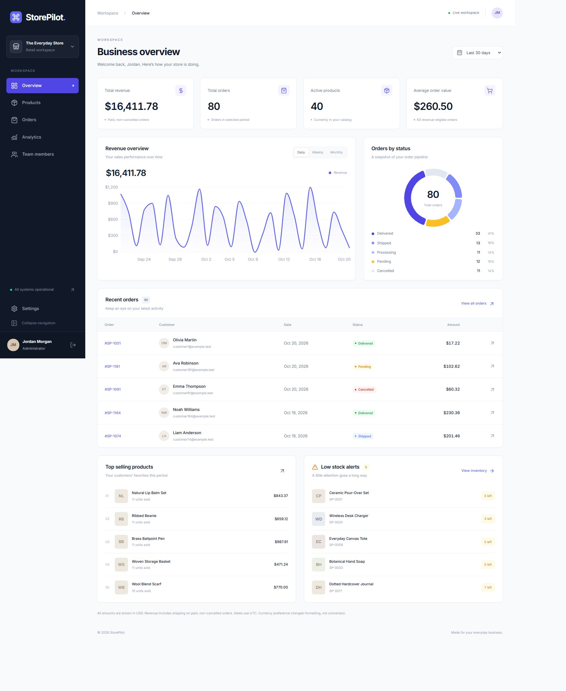

# StorePilot

A full-stack retail workspace for small businesses: inventory, fulfillment, sales insights, and team access in one focused interface. Built with React and TypeScript, an Express REST API, and MongoDB. Every dashboard metric comes from stored orders and MongoDB aggregations.

## Features

- Cookie-based authentication with Argon2id password hashes, 15-minute JWT access tokens, rotating refresh sessions, replay revocation, CSRF checks, and login rate limiting.
- Admin and Staff permissions enforced by Express. Staff can read the dashboard/catalog/orders and advance fulfillment. Admins manage products, cancellations, team members, analytics, and shop settings.
- Validated product creation/editing, safe archiving, name/SKU search, category/stock filters, sorting, and server pagination.
- Order details with historical item snapshots, allowed status transitions, actor history, and transactional cancellation/stock restoration.
- Revenue and order charts with daily/weekly/monthly grouping, 7/30/90-day and custom date ranges, category revenue, top products, and low-stock alerts.
- Persistent profile/shop settings, password changes with session invalidation, protected client routes, responsive navigation, keyboard focus, confirmation dialogs, toasts, and error/loading/empty states.

## Screenshots

Captured from the live seeded local application:



[Products](docs/screenshots/products.png) · [Order details](docs/screenshots/order-details.png) · [Mobile dashboard](docs/screenshots/mobile-dashboard.png)

## Stack and architecture

React 19 · TypeScript · Vite · Tailwind CSS 4 · React Router · TanStack Query · Axios · React Hook Form/Zod · Recharts · Lucide · Sonner. Express 5 · Mongoose 8 · MongoDB 8 · JWT · Argon2 · Helmet · CORS · express-rate-limit. Vitest, Testing Library, Supertest, ESLint, Prettier.

```text
client/src/
  app/          routing, authentication provider, error boundary
  components/   responsive shell, UI primitives, charts
  features/     product form and permitted order actions
  pages/        login, dashboard, products, orders, analytics, users, settings
  lib/          Axios, CSRF/refresh handling, formatting
  types/        API record types
  tests/        interaction and route tests
server/src/
  config/       validated environment configuration
  models/       users, products, orders, sessions, shop, admin guard
  middleware/   authentication, roles, CSRF, public serialization
  validators/   strict request schemas
  services/     sessions, order transitions, monetary rules, aggregations
  scripts/      repeatable demo provisioning
  tests/        integration tests on an isolated MongoDB replica set
  app.ts        REST routing, validation, error mapping
  index.ts      database connection and graceful shutdown
```

The Vite development server proxies `/api` to Express. Production should serve the client and `/api` under a single origin. MongoDB replica-set transactions protect inventory restoration and serialize changes to active admin membership. Records use MongoDB ObjectIds; money uses integer minor units end-to-end. Password hashes and session secrets are excluded from API responses.

## Local setup

Requirements: Node.js **22.12+**, npm, and an existing MongoDB server executable or a MongoDB replica set. Docker Compose is an optional alternative. Node 22.18 is suitable. Vite 7's runtime requirements are documented in the [official Vite guide](https://v7.vite.dev/guide/); Mongoose 8 supports MongoDB 8 per its [compatibility guide](https://mongoosejs.com/docs/8.x/docs/compatibility.html).

### This machine: use the already installed server on I:

Dependencies are already installed and an ignored `server/.env` has been created with random local-only credentials. **No downloads or installation are needed.** Run:

```powershell
npm.cmd run dev:local
```

Start your existing server manually, as usual:

```powershell
mongod --dbpath "I:\My downloads\data"
```

`server/.env` uses `MONGODB_URI=mongodb://127.0.0.1:27017/storepilot` (no `replicaSet` parameter). Then run `npm.cmd run dev:local` in another terminal. Open **http://localhost:5173** (matching `CLIENT_ORIGIN`). StorePilot only connects to that server; it does not launch/stop MongoDB, initiate/reconfigure a replica set, seed data, or automatically create collections/indexes. Its temporary files remain under `.cache/local-tmp` on I:. Stopping the app only disconnects its client.

The existing server is standalone. Login/refresh, reads, product operations, and atomic fulfillment updates support standalone operation. Cancellation with stock restoration, team updates, password changes, and the original full seed require multi-document transactions and return a clear error before changing data on standalone MongoDB. StorePilot does not reconfigure the server to enable them. The standalone historical import (`npm.cmd run seed:demo`) is separate and insert-only. After explicit approval, the local database now has one admin, 40 demo products, and 240 demo orders. Startup itself still creates no accounts or demo records. See [existing MongoDB configuration and verification](docs/mongodb-local.md).

On another machine with an existing server, configure local-only secrets without overwriting an existing environment file:

```powershell
node scripts/configure-local.mjs
```

Set `MONGODB_URI` in `server/.env` to your existing server and intended application database. The setup helper creates project configuration only; it never connects to MongoDB. Download/install commands require your approval before execution.

### Manual setup / optional Docker

```powershell
npm.cmd install
Copy-Item server/.env.example server/.env
```

Edit `server/.env`. Set `JWT_SECRET` to a random value of at least 32 characters and `SEED_PASSWORD` to a local demo password of at least 12 characters. Choose the three `SEED_*_EMAIL` values. Generate a secret with:

```powershell
node -e "console.log(require('node:crypto').randomBytes(48).toString('hex'))"
```

Start MongoDB, wait until healthy, provision demo data, and start both apps:

```powershell
docker compose up -d --wait
npm.cmd run seed
npm.cmd run dev
```

Open [the local workspace](http://localhost:5173). The API listens on port 4000. On shells without PowerShell execution-policy restrictions, `npm` works in place of `npm.cmd`.

### Login and local CSRF checks

The default Vite URL is `http://localhost:5173` with a fixed port. Development also permits `127.0.0.1`/IPv6 loopback on the same scheme and port; production accepts only the configured `CLIENT_ORIGIN`. Cookies and matching CSRF headers are still required. The client refreshes a stale CSRF token and retries the rejected request once; foreign origins remain blocked.

`SEED_ADMIN_EMAIL` and `SEED_PASSWORD` are provisioning inputs, not automatically registered login credentials. The local admin was explicitly created from those values and login was verified. Changing these variables does not reset an existing account's password. For a different empty application database, the insert-only helper below can create one administrator after approval:

```powershell
npm.cmd run provision:admin -w server -- --confirm-create
```

This helper refuses to run without the confirmation flag or when any users already exist. It does not reset passwords, overwrite existing users, or seed products/orders. Do not run it without approving that database change.

### Environment reference

| Variable                                      | Purpose                                                                   |
| --------------------------------------------- | ------------------------------------------------------------------------- |
| `MONGODB_URI`                                 | Existing server URI; defaults to `mongodb://127.0.0.1:27017/storepilot`   |
| `PORT`                                        | Express port, default 4000                                                |
| `CLIENT_ORIGIN`                               | Exact frontend origin for CORS and mutation Origin checks                 |
| `JWT_SECRET`                                  | Required private signing secret, 32+ characters                           |
| `NODE_ENV`                                    | `development`, `test`, or `production`; production enables Secure cookies |
| `SEED_ADMIN_EMAIL`                            | Local demo administrator email                                            |
| `SEED_STAFF_EMAIL`, `SEED_SECOND_STAFF_EMAIL` | Local demo staff emails                                                   |
| `SEED_PASSWORD`                               | Local-only provisioning password, 12+ characters                          |
| `VITE_API_URL`                                | Optional client API base, default `/api/v1`; never put secrets here       |

`.env` files are ignored by Git. No production or public demo credentials are committed. Log in using the emails/password you configured. Repeat seeding does not reset existing passwords or overwrite edited products/inventory. Change an existing password through Settings. Use a new disposable database for a clean demo; do not seed a production database.

### Demo consistency and business rules

For the existing standalone server, use the insert-only catalog/order import:

```powershell
npm.cmd run seed:demo
```

This command connects to the configured server and adds 40 products across five categories and 240 historical orders over approximately 90 days. It never starts MongoDB or provisions/changes users, sessions, shop settings, or guards. Reserved `DEMO-SP-*` SKUs/order numbers, deterministic IDs, and a retained seed date make repeat runs insert missing records only. Existing demo edits are preserved. Foreign records occupying the reserved namespace cause an error before insertion.

The importer fingerprints every pre-existing document and verifies it remains unchanged. Fingerprint receipts stay under `.cache/demo-seed` on I: and contain no plaintext credentials or record contents. New product stock represents the closing inventory after the historical demo sales; importing orders does not decrement any existing stock. Order prices, names, SKUs, and categories are snapshots. Cancelled orders do not consume stock; only paid, non-cancelled orders contribute to recognized revenue.

This is a resumable historical import, not a multi-document transaction. A failed/interrupted run can leave part of the new demo batch present; rerun the same command to complete missing inserts. No rollback deletes or overwrites existing records. The older `npm run seed` remains the replica-set demo-account provisioning script and is separate from this standalone import.

### Original replica-set demo provisioning

The seed creates one admin, two staff, 40 products in five categories, and 240 orders over about 90 days. Unique emails/SKUs/order numbers prevent duplicates. The initial order set and inventory are created in a transaction; later runs preserve existing records. Initial opening stock equals closing stock plus non-cancelled seeded item quantities.

- Stock is deducted/reserved **once at order creation**. This app has no checkout/order-create endpoint; demo provisioning is the only order creation flow. Adding a checkout requires a transactional conditional decrement (`stockQuantity >= quantity`) before creating the order.
- Allowed transitions: `Pending → Processing → Shipped → Delivered`. Admins may cancel from Pending or Processing. Staff may perform only fulfillment transitions. Delivered/Cancelled are terminal. Changes record actor and time.
- Cancellation atomically restores item quantities once. A paid cancelled order becomes `Refunded`; this is an accounting demo marker, not a payment-provider refund.
- Revenue sums `totalAmount` (items plus shipping) for **Paid, non-Cancelled** orders created in the chosen UTC interval. Unpaid, Refunded, and Cancelled orders never contribute. AOV divides that revenue by eligible paid order count and rounds to a minor unit. Total Orders includes every payment/status state; Active Products is the current catalog count, independent of date range.
- Category and top-product revenue use item totals and exclude shipping. Category/name/price snapshots preserve historical reporting. Empty time buckets show zero. Weekly buckets begin Monday, all chart boundaries use UTC. Custom ranges are limited to 367 days.
- Archiving never deletes a product or its order references. Stock edits represent explicit inventory corrections; fulfillment status changes do not deduct stock again.
- Currency is a display preference. No exchange-rate conversion or multi-currency accounting is implemented; use one accounting currency.
- A shared transactional guard prevents concurrent removal of the last active admin. Role changes/deactivation revoke sessions; password changes invalidate all access and refresh sessions.

## Verification

```powershell
npm.cmd test
npm.cmd run build
npm.cmd run lint
npm.cmd run format
```

Standalone safety tests use mocks and do not start MongoDB:

```powershell
node node_modules/vitest/vitest.mjs run --config server/vitest.config.ts server/src/tests/standalone.test.ts server/src/tests/auth-standalone.test.ts server/src/tests/orders-standalone.test.ts
```

`npm.cmd test` runs these standalone unit tests plus frontend jsdom tests, without starting MongoDB. The explicitly separate integration suite (`npm.cmd run test:integration -w server`) starts an isolated replica set and is not part of `dev:local` or default tests. Do not run it under a no-separate-instance constraint. Automatic downloads are disabled; its temporary files stay on I: under `.cache/test-tmp`. See [verification results](docs/verification.md).

## API overview

All endpoints are under `/api/v1`. Successful records use `{ data }`; list responses add `{ meta: { total, page, limit } }`; errors use `{ error: { message, fields? } }`. Deletion/logout/password change return 204. Dates are ISO 8601. Amounts are integer minor units.

| Endpoints                                                                            | Access                                |
| ------------------------------------------------------------------------------------ | ------------------------------------- |
| `GET /health`, `GET /auth/csrf`, `POST /auth/login`, `/auth/refresh`, `/auth/logout` | Public (mutations require CSRF)       |
| `GET /auth/me`                                                                       | Authenticated                         |
| `GET /products`, `/products/:id`                                                     | Admin, Staff                          |
| `POST /products`, `PATCH /products/:id`, `DELETE /products/:id`                      | Admin                                 |
| `GET /orders`, `/orders/:id`, `PATCH /orders/:id/status`                             | Authenticated; transition rules apply |
| `GET /analytics/overview`                                                            | Admin, Staff dashboard                |
| `GET /analytics/revenue`, `/analytics/orders`, `/analytics/top-products`             | Admin                                 |
| `GET /users`, `POST /users`, `PATCH /users/:id`                                      | Admin                                 |
| `GET /settings`, `PATCH /profile`, `POST /profile/password`                          | Authenticated                         |
| `PATCH /settings`                                                                    | Admin                                 |

List parameters: `page`, `limit` (1–100), `search`, `sort`, `direction`. Product filters: `category`, `stock` (`low`, `out`, `healthy`), `active` (`true`, `false`, `all`). Orders: `status`, `from`, `to`. Analytics: `from`, `to`, `group` (`daily`, `weekly`, `monthly`). Products accept integer `price`, `stockQuantity`, `lowStockThreshold`. Status updates accept `{ "status": "Processing" }`.

Cookie-authenticated mutations must first obtain `/auth/csrf`, retain its cookie, and send the returned token as `X-CSRF-Token`. Access/refresh tokens never use localStorage. Refresh sessions last seven days and rotate on use; replay revokes the entire family, including its access tokens. Multiple tabs should coordinate refresh in a production extension to avoid legitimate simultaneous rotation being treated as replay.

## Deployment requirements

No deployment has been performed. Build both workspaces, run `npm run start -w server`, and serve `client/dist` from a static host/reverse proxy with SPA history fallback. Proxy `/api` to Node and use HTTPS on the same origin. Configure `NODE_ENV=production`, a private random `JWT_SECRET`, `CLIENT_ORIGIN`, and a private MongoDB replica-set URI. Secure cookies require HTTPS. Do not expose MongoDB publicly. Configure Express `trust proxy` for your actual proxy topology before relying on IP rate limiting behind a proxy; use a shared limiter store for multiple Node replicas. Back up MongoDB, monitor logs, rotate secrets through an operational process, and supply a production process manager. This scoped portfolio app does not include billing, password recovery, a checkout, external payments, or uploads.
